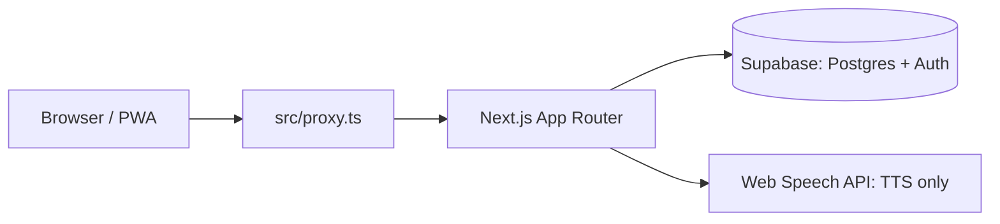

# Project map

Codebase map for `english_learning`. Full plan, decisions, roadmap and content
sourcing live in the dev plan doc — this file only tracks what actually exists
in the repo and how it fits together: https://claude.ai/artifact/2giVckYHw8DefDkW7KQTsE

## Architecture

- **`src/proxy.ts`** runs before every request (Next.js 16's replacement for
  `middleware.ts`): refreshes the Supabase session and redirects signed-out
  users to `/login`. Route matching is in `PUBLIC_PATHS` inside
  `src/lib/supabase/middleware.ts`.
- **Auth**: email + password; sign-up/reset confirmed by an emailed code. All auth runs in server actions (`src/lib/auth.ts`) so cookies are set by `Set-Cookie`; the proxy refreshes the session (`getClaims()`).
- **Data**: all reads/writes go through the Supabase clients in
  `src/lib/supabase/` — `server.ts` (Server Components /
  Route Handlers). Never call Postgres directly from a component.

## Directory map

| Path | Purpose |
| --- | --- |
| `src/app/layout.tsx` | Root HTML shell: fonts (Inter, Geist Mono), dark theme background |
| `src/app/globals.css` | Design tokens from `docs/DESIGN.md`, wired into Tailwind v4 `@theme` |
| `src/app/(auth)/login/` | Sign-in screen, no nav (route group has its own layout) |
| `src/app/(app)/` | Everything behind auth, wrapped by `NavBar` in `(app)/layout.tsx` |
| `src/app/(app)/page.tsx` | Lesson path (route `/`): streak card (lessons today / 3) + `LessonPath` |
| `src/app/(app)/dashboard/page.tsx` | Progress dashboard: streak, words learned, grammar, 12-week activity calendar, minutes per strand (route `/dashboard`) |
| `src/app/manifest.ts`, `src/app/apple-icon.png`, `public/icon-*.png` | PWA manifest + icons |
| `public/sw.js`, `public/offline.html` | Service worker: cache-first build assets, network-first pages with last-good-copy fallback, offline page. Registered by `components/ServiceWorker.tsx` (production only) |
| `src/components/AuthForm.tsx` | Sign-in / sign-up / code / reset forms (client, calls `src/lib/auth.ts` actions) |
| `src/lib/auth.ts`, `auth-validation.ts` | Auth server actions; pure validators and Russian error messages |
| `src/app/(app)/session/vocab/` | Lesson «Слова»: SM-2 card review (`VocabSession`) |
| `src/app/(app)/session/grammar/` | Lesson «Грамматика»: grammar lesson — rule summary + exercises for the current unit (`GrammarSession`) |
| `src/app/(app)/session/reading/` | Lesson «Чтение»: today's text with studied words highlighted + true/false check (`ReadingSession`) |
| `src/app/(app)/session/context/` | Lesson «Слова в контексте»: type the blanked word of an example sentence, Russian meaning as hint (`ContextSession`) |
| `src/app/(app)/session/build/` | Lesson «Собери предложение»: arrange shuffled English words for a Russian sentence (`BuildSession`) |
| `src/app/(app)/session/translate/` | Lesson «Перевод»: type the English translation of a Russian phrase (`TranslateSession`) |
| `src/app/(app)/session/review/` | Lesson «Повтор ошибок»: grammar exercises whose latest attempt was wrong; empty → auto-completed (`GrammarSession` with `step="review"`) |
| `src/content/phrases.ts` + `phrases/part-1…8.ts` | Hand-written RU→EN phrase corpus: 690 build + 690 translate (6 per path section ↔ grammar unit, A1→B1, difficulty rises with position; proofread). Batches are chosen by path cycle (`?n=` in the lesson link). `phrases.test.ts` / `texts.test.ts` enforce the difficulty ladder |
| `src/components/` | Shared UI (`NavBar`, `LessonPath`, `StepComplete`) and the per-lesson session components |
| `src/lib/supabase/` | Supabase client factories + session-refresh logic used by `proxy.ts` |
| `src/lib/supabase/types.ts` | DB types generated from the live project + convenience aliases at the bottom (regenerate after schema changes) |
| `src/lib/srs.ts` | Pure SM-2 spaced-repetition function (`reviewCard`) — no I/O, unit-testable |
| `src/lib/vocab.ts`, `grammar.ts`, `reading.ts`, `practice.ts` (context + review lessons) | Server actions per lesson type: pick the next material, record results. Grammar answers are checked server-side |
| `src/lib/highlight.ts` | Pure splitter that finds studied headwords (+ simple inflections) in a text |
| `src/lib/dates.ts` | Local-day math + streaks (3+ lessons in a local day = streak day; a missed day breaks it) — pure |
| `src/lib/path.ts` | Pure lesson-path model: lesson `i` has type `PATTERN[i % 4]` (vocab, context, grammar, build, reading, translate, review); position = lifetime finished lessons; one section = one pass of 7 |
| `src/lib/day-server.ts` | Learner's timezone (from the `tz` cookie set by `TimezoneCookie`), today's local date, `recordStep` → `record_step()` RPC |
| `src/lib/overview.ts` | Read models for the path (lessons total/today, streak) and the dashboard |
| `src/lib/*.test.ts` | Vitest unit tests for the pure modules (`dates`, `path`, `srs`, `highlight`, `plural`); config in `vitest.config.ts`; run `npm test` before deploys |
| `src/lib/speech.ts` | Web Speech TTS wrapper (`speak`) for vocabulary pronunciation |
| `src/docs/` | The two textbook PDFs (grammar: Murphy, *Essential Grammar in Use*; words: Nation, *4000 Essential English Words 1*) — personal copies, git-ignored (copyrighted, never commit them) |
| `supabase/content/` | Hand-written content as JS modules (`grammar-topics.mjs`, `grammar-exercises.mjs`, `texts.mjs` + `texts-part-1…8.mjs` (115 reading texts, text N ↔ grammar unit N), `words.mjs`) + `build-seed.mjs` / `build-words.mjs`, which validate them and generate `supabase/seed_phase2.sql` / `seed_words.sql` |
| `supabase/migrations/0001_init.sql` | Full schema: `words`, `texts`, `grammar_exercises`, `cards`, `sessions` + RLS policies |
| `supabase/migrations/20261031004150_lessons_streak.sql` | `sessions.lessons_completed`; `record_step` counts every finished lesson (streak day = 3+, path position = total); drops listening tables/enum/column, fluency columns, `completed_steps` and the unused `progress` table; `fluency_minutes` → `practice_minutes` |
| `supabase/migrations/20260923202717_daily_steps.sql` | Фаза 4: `sessions.completed_steps` + `grammar_minutes`, `record_step(date, step, minutes)` |
| `supabase/migrations/20260923183643_…`–`…183653_…` | `words.sort_order` (learning order of new words) + `words.source` |
| `supabase/migrations/20260923180828_…`–`…181706_…` | Фаза 2: `grammar_topics` (one row per textbook unit), exercises linked to topics, `grammar_attempts`, `text_reads`, text questions |
| `docs/DESIGN.md` | Visual style reference (Raycast-style dark theme) |

## Routes

| Route | Auth | Screen |
| --- | --- | --- |
| `/login` | public | Sign in / register / reset password |
| `/` | required | Lesson path — streak, lessons today, zigzag path with the current lesson highlighted |
| `/session/vocab` | required | SRS card review |
| `/session/grammar` | required | Current grammar unit: first unit with exercises not yet mastered (latest attempt at every exercise correct); a retry serves only the mistakes |
| `/session/reading` | required | First unread text in catalog order (then the least recently read one) |
| `/session/context`, `/build`, `/translate` | required | Practice lessons; `?n=<cycle>` selects the batch |
| `/session/review` | required | Grammar mistakes (latest attempt wrong), up to 6 |
| `/dashboard` | required | Progress stats |

## Status vs. the plan's phases

- ✅ **Фаза 0** — project skeleton, Supabase schema + auth, base layout/nav, empty dashboard.
- ✅ **Фаза 1** — vocabulary (825 words: starter set + all 600 words of the vocabulary textbook interleaved with 150 IT terms), SM-2 review screen, Web Speech TTS.
- ✅ **Фаза 2** — reading screen (12 texts A1-A2) and grammar lessons: all 115 textbook units in `grammar_topics`, summaries + 98 exercises for units 1-12. More units = more entries in `supabase/content/grammar-exercises.mjs`.
- ✅ **Фаза 3** — replaced later by the practice lessons (context, build, translate, review); listening and fluency were removed.
- ✅ **Фаза 4** — PWA (manifest, icons, service worker, offline page), `experimental.useOffline` (Server Actions retry after reconnect; vocab reviews queue while offline), lesson tracking per local day, streaks, real dashboard.
- ⬜ **Фаза 5** (optional) — paid TTS/STT, placement test, AI writing feedback.

Update this file when the directory structure or route map changes; it's meant
to stay a fast orientation point, not a duplicate of the full plan doc.
